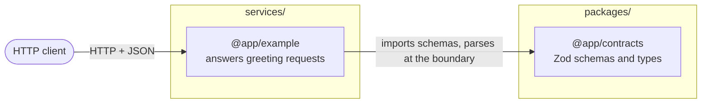

# Architecture

The workspace packages and how they depend on each other. Every package in `packages/` and `services/` must appear here by its package name; `pnpm check:diagrams` fails otherwise.

Rules the diagram reflects (from `AGENTS.md`):
- `@app/contracts` is the only package other packages may import.
- Services talk to each other over HTTP, never by importing each other. A service-to-service edge is labeled with its protocol.
